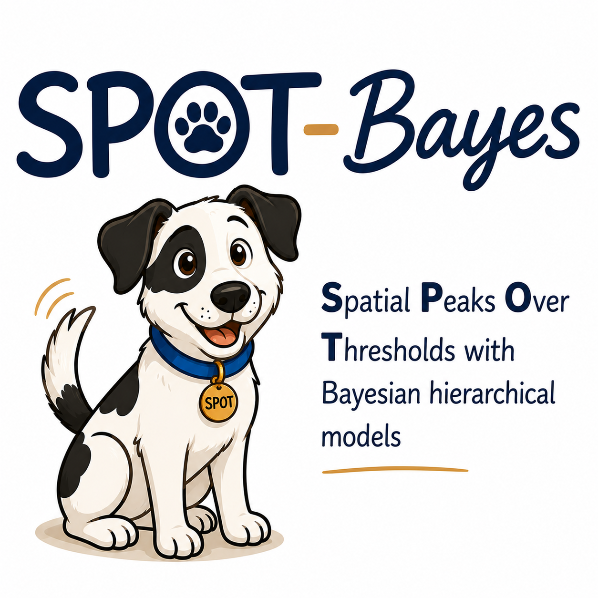

<p align="center">
  
</p>

# spot-bayes

**S**patial **P**eaks **O**ver **T**hresholds with **Bayes**ian hierarchical models.

`spot-bayes` fits Bayesian spatial-extremes models to threshold exceedances by MCMC.
It merges two codebases: Muyang Shi's GPD scale-mixture model (multiplicative
log-Laplace nugget, nonstationary Matérn) and Chien-Chung Wang's model for non-convex
domains with physical barriers (VisGP covariance, visibility-filtered Wendland kernels, anisotropy).
All three model types share Shi's GPD + nugget tail construction:

| `model` | Dependence structure |
|---|---|
| `shi` | Nonstationary Matérn Gaussian field; spatially varying tail exponent φ(s) and range ρ(s) |
| `wang` | Barrier-aware: VisGP covariance on a visibility graph, Wendland kernels filtered by line of sight, anisotropy |
| `huser-wadsworth` | Single random scale: stationary Matérn with a scalar tail exponent φ |

Features:

- GPD margins either held fixed or estimated by regression on spatial, temporal and
  spatio-temporal covariates; a two-stage (margins first, then dependence) workflow is
  supported.
- Serial and MPI samplers (MPI parallelises over time replicates) that share one
  implementation of every update block; both are regression-tested against byte-exact
  golden chains.
- Gradient-based NUTS updates for the latent field and several parameter blocks,
  alongside adaptive random-walk Metropolis.
- Checkpoint/resume (bit-exact) and chain extension; latent traces can be streamed to disk.
- Held-out scoring (log score, CRPS, threshold-weighted CRPS), conditional WAIC, and
  prediction at new sites.
- Missing data handled by conditional imputation.

## Installation

The package is plain Python modules plus one C++ extension (closed-form random-scale
transforms via GSL). With conda:

```bash
conda env create -f environment.yml     # creates the `extremes` environment
conda activate extremes
make -C cpp                             # builds cpp/rw_inte_cpp.so
python -m pytest tests/ -q              # run from the repo root
```

`environment.yml` installs MPICH with an `mpi4py` built against it. Any MPI works as
long as `mpiexec` and `mpi4py` come from the **same** MPI: a mismatched
pair (e.g. a system Open MPI `mpirun` with an Intel-MPI `mpi4py`) silently runs every
rank as an independent single-process job. Put the environment's own launcher first on
`PATH`:

```bash
export PATH="$CONDA_PREFIX/bin:$PATH"
mpiexec -n 4 python ...
```

Run one BLAS/OpenMP thread per MPI rank (`OMP_NUM_THREADS=1 OPENBLAS_NUM_THREADS=1
MKL_NUM_THREADS=1`); the analysis scripts set this for you. Oversubscribing cores is
slow and can overheat a laptop.

## Quick start

`scripts/run_sampler.py` fits a model to a data directory containing `Y.npy` (Ns × Nt;
NaN = missing), `sites_xy.npy` (Ns × 2), and per-site `u.npy` (threshold), `sigma.npy`
and `xi.npy` (GPD scale and shape):

```bash
# Shi model
python scripts/run_sampler.py --model shi --data-dir ./data --n-iters 5000 --out shi.npz

# Wang model with a barrier: VisGP covariance + barrier-filtered kernels
python scripts/run_sampler.py --model wang --use-visgp --use-barrier-kernels \
    --shapefile domain.shp --cliques cliques.rds --data-dir ./data

# Huser-Wadsworth with phi in (0, inf), on 8 MPI ranks
mpiexec -n 8 python scripts/run_sampler.py --model huser-wadsworth --phi-domain positive \
    --data-dir ./data --mpi
```

`python scripts/run_sampler.py --help` lists every option. `scripts/score_holdout.py`
scores a fitted run on held-out sites, and `scripts/compute_cliques.R` builds the
junction-tree cliques for a VisGP graph.

From Python, the entry points are `config.ModelConfig` (model and feature selection),
`sampler.SamplerData` / `sampler.SamplerSettings`, and `sampler.run_mcmc` (serial) or
`sampler_mpi.run_mcmc_mpi` (MPI).

## Worked examples

Two complete analyses, each with its data, scripts and a vignette that runs from data
preparation to model comparison:

- [`faroe_analysis/`](faroe_analysis/README.md): extreme significant wave heights around
  the Faroe Islands, where the islands act as a barrier to storms arriving from
  different directions.
- [`nz_analysis/`](nz_analysis/README.md): extreme atmospheric-river precipitation on
  New Zealand's South Island, where the Southern Alps create a rain shadow.

Both fit all three models on a train/test split, compare them on held-out sites, and
assess the best fit. Each includes example Slurm scripts for running on a cluster.

## GPD marginal regression

The GPD scale and shape can be estimated with covariates instead of held fixed. Each is
a link-transformed linear predictor:

    sigma(s,t) = exp(eta_sigma(s,t))
    xi(s,t)    = -0.5 + 1.5 * sigmoid(eta_xi(s,t))        # maps R -> (-0.5, 1)
    eta(s,t)   = beta0
               + spatial[s,:] . beta_sp           (varies in space, constant in time)
               + temporal[t,:] . beta_tp          (varies in time, constant in space)
               + spatiotemporal[s,t,:] . beta_st  (varies in both)

For each parameter you may pass any subset of three covariate arrays; an intercept is
always added:

| group | shape | example |
|---|---|---|
| spatial | `(Ns, p_sp)` | elevation |
| temporal | `(Nt, p_tp)` | year, ENSO index |
| spatiotemporal | `(Ns, Nt, p_st)` | local temperature |

In Python, pass `sigma_spatial` / `sigma_temporal` / `sigma_spatiotemporal` (and the
`xi_*` analogues) to `SamplerData` and set `update_GPD_sigma` / `update_GPD_xi` in
`SamplerSettings`. On the command line: `--update-gpd-sigma --sigma-spatial elev.npy ...`.
Coefficients get `N(0, sd^2)` priors (`sigma_beta_sd` / `xi_beta_sd`), and the intercept
is initialised from the median of `sigma_vec` / `xi_vec`. With the flags off, `sigma_vec`
/ `xi_vec` are used as given.

`marginal_model.py` fits the margins on their own (stage 1 of the two-stage workflow).
`recursive_bayes.py` implements an exact recursive-Bayes update that carries the stage-1
posterior into the full model; see
[`docs/two_stage_recursive_bayes.md`](docs/two_stage_recursive_bayes.md).

## Sampler options

Each block's sampler is chosen in `SamplerSettings`. The defaults are conservative; the
worked examples use the settings we recommend for real data (NUTS for the latent field).

| setting | default | alternatives |
|---|---|---|
| `z_sampler` (latent Gaussian field) | `"rwmh"` (non-centred, whitened) | `"nuts"` (per-time NUTS; recommended), `"ess"` (elliptical slice) |
| `s_sampler` (random scales) | `"nuts"` | `"component"`, `"joint"`, `"indep"`, `"both"` |
| `phi_sampler` (tail exponent knots) | `"rwmh"` | `"barker"`, `"nuts"` |
| `nu_rho_sampler` (Matérn smoothness and range) | `"separate"` | `"nuts"` (joint; `shi` only) |
| `beta_sampler` (GPD regression) | `"component"` | `"rwmh"` (joint), `"barker"`, `"nuts"`, `"recursive"` (two-stage) |

Adaptive random-walk blocks tune their proposal scale and covariance during the run. NUTS
blocks adapt their step size by dual averaging over `nuts_warmup` sweeps and then freeze it.

## Checkpointing, resume and extending a chain

Both samplers checkpoint periodically (`--checkpoint-every N`) and resume with
`--resume`. Resume restores the state, the adaptive tuning and the RNG, so a resumed
chain is bit-identical to one that ran uninterrupted.

With `<ckpt>` the checkpoint path (`--checkpoint-path`, default `<out>.ckpt`):

| file | contents |
|---|---|
| `<ckpt>.pkl` | serial checkpoint: state, adaptive tuning and RNG |
| `<ckpt>.global.pkl`, `<ckpt>.rank{r}.pkl` | MPI checkpoint: global state on rank 0, plus each rank's slice of the latent fields |
| `<out>.Z.npy`, `<out>.S.npy` | streamed latent traces, one memmap row per recorded sample (`--stream-latent`) |
| `<out>` | the saved run. With `--stream-latent` the parameter traces so far are also written here at each checkpoint, so progress can be inspected mid-run (otherwise they go to `<ckpt>.traces.npz`). |

To extend a chain that has finished but not converged, relaunch with a larger
`--n-iters` and `--resume`. The streamed latent traces grow in place and the chain
continues from the checkpointed state. Shrinking `--n-iters` below the saved length is
refused.

## Known limitations

- `alpha0` (the nugget's log-Laplace rate) and the Matérn smoothness `nu` are weakly
  identified on small datasets and can mix slowly; expect long chains for them.
- In the joint `nu_rho_sampler="nuts"` block, the `nu` gradient sums many terms of
  alternating sign, which cancel badly at large `nu` and `rho`. The gradient can then
  be inaccurate. This cannot bias the posterior, because the accept step uses the exact
  density, but it can make proposals worse. The sampler warns when a fit enters that
  region; see [`docs/nurho_quadrature.md`](docs/nurho_quadrature.md).

## Repository layout

| path | contents |
|---|---|
| `config.py` | `ModelConfig`: model and feature selection, CLI arguments |
| `sampler.py`, `sampler_mpi.py` | serial and MPI MCMC drivers, save/load |
| `mcmc_updates.py` | every MCMC update block (shared by both drivers), adaptive RWMH, NUTS |
| `utilities.py`, `priors.py` | core model math: GPD, Lévy, Matérn, priors and transforms |
| `covariance.py`, `kernels.py`, `domain.py` | Matérn and VisGP covariance; Wendland kernels (standard, anisotropic, barrier); shapefile → visibility graph and cliques |
| `rw_inte.py`, `cpp/` | closed-form random-scale CDF/quantile/density (C++/GSL) |
| `phi_transform.py`, `phi_gradient.py`, `gamma_order_deriv.py`, `bessel_nu.py` | tail-exponent parametrisation and the special-function derivatives behind the gradient samplers |
| `marginal.py`, `marginal_model.py`, `recursive_bayes.py` | GPD marginal regression and the two-stage workflow |
| `init_field.py` | data-driven starting values for the latent field |
| `missing_data.py`, `predictive.py`, `diagnostics.py` | imputation; held-out scoring, WAIC and new-site prediction; live trace plots and ESS |
| `simulate.py` | forward simulation from all three models |
| `scripts/` | command-line entry points |
| `faroe_analysis/`, `nz_analysis/` | worked examples |
| `tests/` | test suite, including byte-exact golden fixtures for both samplers |
| `docs/` | [architecture guide](docs/architecture.md) and design notes |

## Tests

```bash
conda activate extremes
make -C cpp
python -m pytest tests/ -q                                  # everything
python -m pytest tests/ -q --ignore=tests/test_sampler.py   # skip the slower sampler runs
```

`tests/test_sampler_golden.py` checks that both samplers reproduce committed chains
byte for byte (the MPI case runs `mpiexec -n 2`), and `tests/test_checkpoint.py` checks
that a resumed chain is identical to an uninterrupted one.

## Data

The example datasets are derived from the Copernicus Marine Service Global Ocean Waves
Reanalysis (Faroe) and the ECMWF ERA5 reanalysis from the Copernicus Climate Change
Service (New Zealand). See the "Data sources" sections of
[`faroe_analysis/README.md`](faroe_analysis/README.md#data-sources) and
[`nz_analysis/README.md`](nz_analysis/README.md#data-sources) for products, DOIs,
licences and processing.

## Acknowledgements

The GPD scale-mixture model and much of the core numerical code come from Muyang Shi's
[`GPD_ScaleMixture`](https://github.com/muyangshi/GPD_ScaleMixture). The
non-convex-domain model (VisGP covariance, barrier kernels, the Faroe cliques and
covariates) comes from Chien-Chung Wang's *Spatial Extremes on Domains with Physical
Barriers* (paper forthcoming). Chien-Chung Wang also prepared the New Zealand
precipitation data, covariates and visibility graph.

## Contributing

Bug reports, fixes and new models are welcome. See [`CONTRIBUTING.md`](CONTRIBUTING.md)
for setup, the test rules and how to propose changes, and
[`docs/architecture.md`](docs/architecture.md) for how the code fits together.

## License

MIT; see [`LICENSE`](LICENSE).
