# Faroe Islands Extreme Waves — Modeling Vignette

This vignette walks through a full spatial-extremes analysis of storm-season significant
wave height around the Faroe Islands.

- **Part I — data and marginal pre-processing** takes the Copernicus wave reanalysis down
  to 5-day storm-season block maxima, fits a spatial **0.95-quantile-regression threshold**,
  and fits a **GPD marginal model** (spatially varying scale σ and shape ξ) by maximum
  likelihood.  Its outputs ship in `faroe_analysis/data/`, so you never need to re-run it.
- **Part II — Bayesian spatial-dependence modeling** fits three full Bayesian
  spatial-extremes models with the [`spot-bayes`](https://github.com/bshaby/spot-bayes)
  package, compares them on held-out locations, and assesses the best one.

The scientific question is **directional sheltering**: storms arrive from different
directions and the islands block extreme waves, so the *extremal dependence* should be
anisotropic and shaped by the barrier.

All the modeling code lives in `faroe_analysis/scripts/` as `faroe_*.py` and
`run_faroe_task*.sh`.

---

# Part I — Data and marginal pre-processing

Sections I.4–I.6 are reproduced by `faroe_analysis/scripts/faroe_preprocess.py`
(serial, about 30 seconds), starting from the shipped block maxima. It writes to
`faroe_analysis/output/preprocess/` and matches the shipped
`data/faroe_workflow_outputs.npz` to optimizer tolerance. The download, block
construction and storm-duration EDA (I.2–I.3) used the 3-hourly Copernicus data, which
is not included; they are described here for completeness.

## I.1 Problem and domain

The statistical target is extreme significant wave height, `VHM0`, in the North Atlantic around the Faroe Islands.  The physical geography matters: the islands are not just missing grid cells, they can also act as barriers that interrupt spatial dependence and alter wave exposure.  A grid cell west of the islands and a grid cell east of the islands can be close in Euclidean distance but quite different in exposure to incoming Atlantic storms.

The analysis domain is a 21 by 21 latitude-longitude grid spanning approximately 60-64 degrees north and -9 to -5 degrees east.  A buffered polygon around the islands is used as a land/barrier mask.  Grid-cell centers inside that polygon are excluded from fitting.

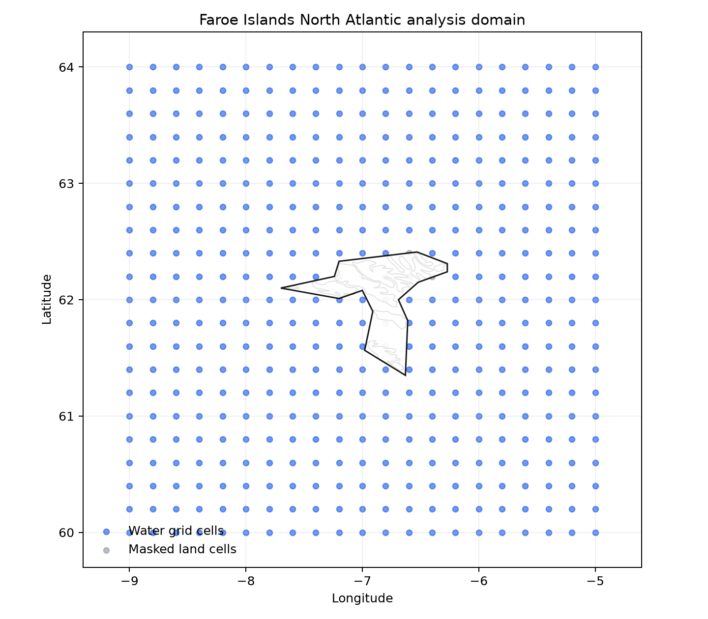

The mask used throughout is:

```python
BUFFER_X = np.array(
    [-7.7, -7.2, -7, -6.91, -6.98, -6.63, -6.61, -6.69, -6.52, -6.27, -6.27, -6.53, -7.2, -7.24]
)
BUFFER_Y = np.array(
    [62.1, 62.01, 62.08, 61.9, 61.565, 61.35, 61.82, 62, 62.15, 62.24, 62.31, 62.41, 62.33, 62.2]
)
BUFFER_COORDS = np.column_stack([BUFFER_X, BUFFER_Y])

def buffered_land_mask(longitude: np.ndarray, latitude: np.ndarray) -> np.ndarray:
    lon_grid, lat_grid = np.meshgrid(longitude, latitude)
    points = np.column_stack([lon_grid.ravel(), lat_grid.ravel()])
    return MplPath(BUFFER_COORDS).contains_points(points).reshape(lon_grid.shape)
```

## I.2 Copernicus dataset and storm-season subset

The raw wave data are the Copernicus Marine Service *Global Ocean Waves Reanalysis* (product `GLOBAL_MULTIYEAR_WAV_001_032`, dataset `cmems_mod_glo_wav_my_0.2deg_PT3H-i`: 3-hourly significant wave height on a 0.2° ocean grid; DOI [10.48670/moi-00022](https://doi.org/10.48670/moi-00022)).  For this analysis we subset to the North Atlantic region surrounding the Faroe Islands, then further subset in time to the storm season.  The storm season is defined as October 1 through March 31, and the record covers the seasons 1980/81 through 2025/26.

The resulting block maxima are in `faroe_analysis/data/faroe_block_maxima.npz`:

- `block_max`: 5-day maximum `VHM0` (spectral significant wave height), in meters, with shape `(block=1656, latitude=21, longitude=21)`
- `latitude`, `longitude`: the grid coordinates

Each grid cell holds the maximum over each 5-day storm-season block.  In leap-year seasons the block containing February 29 is 6 days, and the last 2 calendar days of each October–March season are dropped so every season splits the same way.

Across all grid cells and blocks, the 5-day maxima range from about 0.79 m to 15.72 m, with a median near 5.66 m and a 95th percentile near 9.43 m.

## I.3 Why 5-day block maxima?

The extreme-value problem is not just to find large waves; it is to identify storm-scale extremes.  A single storm can produce high wave heights over many consecutive 3-hourly or daily observations.  If all those observations are treated as separate extremes, the tail fit overcounts one physical event and creates dependence that the downstream GPD likelihood does not model explicitly.

The initial storm-duration EDA looked at regional maxima, exceedance event durations, autocorrelation, and sensitivity to declustering gap length.  The practical conclusion was that a 5-day block is a reasonable storm-scale reduction: it is long enough to collapse most storm episodes into one maximum, while still retaining enough blocks for spatial tail modeling.

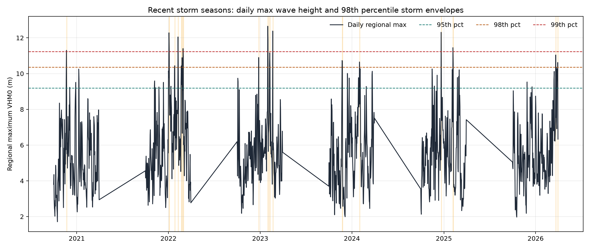

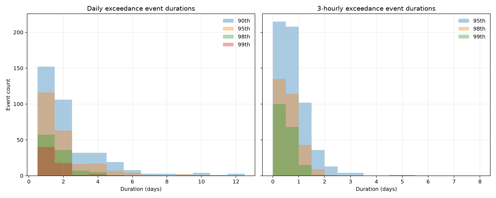

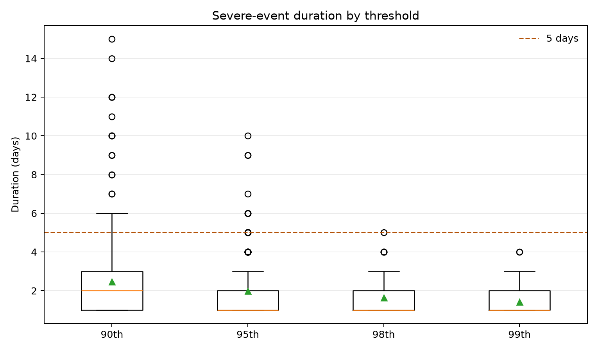

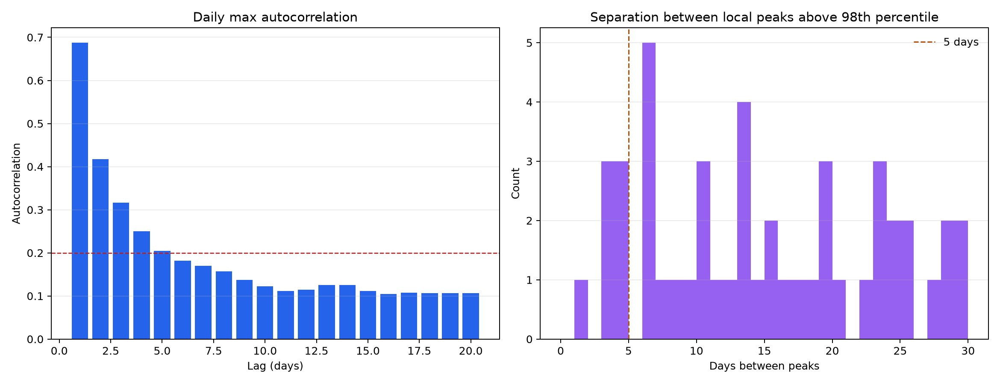

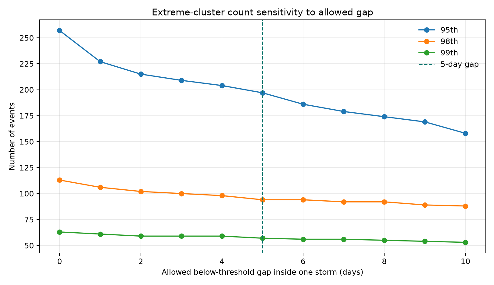

The storm-duration summary shows, for example:

| basis | threshold | events | median days | 90th percentile days | max days |
|---|---:|---:|---:|---:|---:|
| daily | 90th | 367 | 2.0 | 5.0 | 15.0 |
| daily | 95th | 227 | 1.0 | 4.0 | 10.0 |
| daily | 98th | 106 | 1.0 | 3.0 | 5.0 |
| daily | 99th | 61 | 1.0 | 2.0 | 4.0 |
| 3-hourly | 95th | 584 | 0.625 | 1.463 | 5.0 |

Those numbers support using short block maxima instead of raw time points.  The 5-day block is a conservative choice for the highest events while avoiding a severe loss of sample size.

## I.4 Covariates

The covariates come from the barrier-aware spatial-extremes work behind Wang's model (*Spatial Extremes on Domains with Physical Barriers*).  The `mu` covariates are used for the 0.95 quantile surface below.  The `sigma` and `xi` covariates are used for the GPD regression and ship with this analysis as `data/sigma_covariates_std_2stage_MCMC.csv` and `data/xi_covariates_std_2stage_MCMC.csv`.

## I.5 0.95 quantile regression

For each water grid cell, we first compute the empirical location-wise 0.95 quantile of the 5-day maxima.  That gives a noisy but direct pointwise estimate.  We then fit a pooled block-level quantile regression at `tau=0.95`, using covariates that describe spatial trend, smooth spatial structure, depth, distance to the island centroid, exposure angle, and interactions.

The covariate maps are:

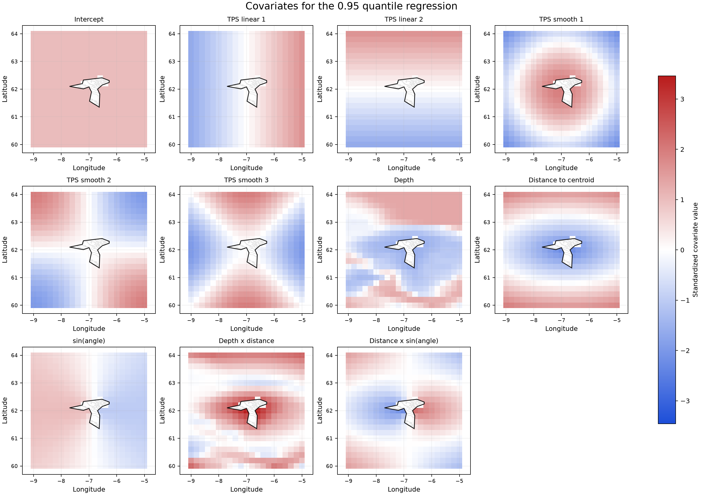

The fitted model uses all block-level observations at all water cells:

```python
def fit_quantile_regression(
    block_max: np.ndarray, covariates: np.ndarray, land_mask: np.ndarray
) -> tuple[np.ndarray, np.ndarray]:
    y_by_location = block_max[:, ~land_mask]
    y = y_by_location.reshape(-1)
    x = np.tile(covariates, (block_max.shape[0], 1))
    keep = np.isfinite(y)

    model = sm.QuantReg(y[keep], x[keep, :])
    result = model.fit(q=TAU, max_iter=5000, p_tol=1e-6)

    fitted_water = covariates @ np.asarray(result.params)
    surface = np.full(block_max.shape[1:], np.nan, dtype=float)
    surface[~land_mask] = fitted_water
    return np.asarray(result.params), surface
```

Several covariate sets were tried before settling on the current `mu` covariate surface.  The main alternatives, against the empirical pointwise 0.95 quantiles:

| model | covariates | RMSE (m) | MAE (m) |
|---|---:|---:|---:|
| Mu covariates | 11 | 0.238 | 0.161 |
| Mu 11 + bathymetric gradient | 12 | 0.235 | 0.157 |
| Selected + interactions | 9 | 0.316 | 0.205 |
| TPS 20 | 21 | 0.538 | 0.444 |
| TPS 10 | 11 | 0.671 | 0.508 |

The bathymetric-gradient extension was very slightly better by RMSE, but the `mu` covariate fit was retained as the current working threshold surface because it is simpler and already aligned with the stage-one covariates.

The map below compares the fitted quantile-regression surface to the pointwise empirical 0.95 quantile.

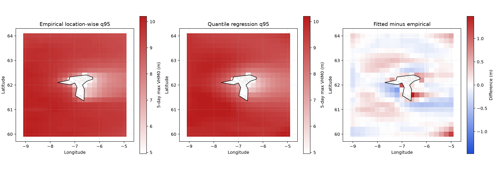

The fit gives:

- q95 fit RMSE against empirical pointwise q95: 0.238 m
- q95 fit MAE against empirical pointwise q95: 0.161 m
- fitted q95 median over water cells: about 9.54 m
- pointwise empirical q95 median over water cells: about 9.52 m

The fitted surface is smoother and more physically interpretable than the raw pointwise quantiles.  It borrows strength across locations and gives a threshold at every water grid cell.

## I.6 GPD analysis above the fitted 0.95 threshold

The fitted quantile-regression surface is used as the high threshold for the peaks-over-threshold analysis.  For water cell `s` and block `t`, the exceedance is:

```text
Y(t, s) = block_max(t, s) - q95_hat(s)
```

only when that value is positive.  This gives 35,776 positive exceedances across 432 water locations.

The model treats positive exceedances as generalized Pareto:

```text
Y | Y > 0 ~ GPD(sigma(s), xi(s))
```

The scale parameter is modeled by a log link:

```text
log sigma(s) = x_sigma(s)' beta_sigma
```

The shape parameter is constrained to `(-0.5, 1)` with a transformed logistic link:

```text
xi(s) = -0.5 + 1.5 * logistic(x_xi(s)' beta_xi)
```

The negative log likelihood implementation is:

```python
def gpd_negative_log_likelihood(params: np.ndarray, y: np.ndarray, x_sigma: np.ndarray, x_xi: np.ndarray) -> float:
    n_sigma = x_sigma.shape[1]
    beta_sigma = params[:n_sigma]
    beta_xi = params[n_sigma:]
    log_sigma = x_sigma @ beta_sigma
    sigma = np.exp(np.clip(log_sigma, -30.0, 30.0))
    xi = xi_from_eta(x_xi @ beta_xi)
    z = y / sigma

    near_zero = np.abs(xi) < 1e-6
    support = 1.0 + xi * z
    invalid = (~near_zero) & (support <= 0.0)
    if np.any(invalid):
        return 1e100 + 1e20 * float(np.sum(-support[invalid] + 1.0))

    nll = np.empty_like(y, dtype=float)
    nll[near_zero] = log_sigma[near_zero] + z[near_zero]
    nz = ~near_zero
    nll[nz] = log_sigma[nz] + (1.0 / xi[nz] + 1.0) * np.log1p(xi[nz] * z[nz])
    if not np.all(np.isfinite(nll)):
        return 1e100
    return float(np.sum(nll))
```

For diagnostics, we also fit location-wise GPD MLEs using the same fitted q95 threshold.  These pointwise fits are noisier because only about 5% of block maxima exceed the threshold at each location, but they provide a useful comparison surface.

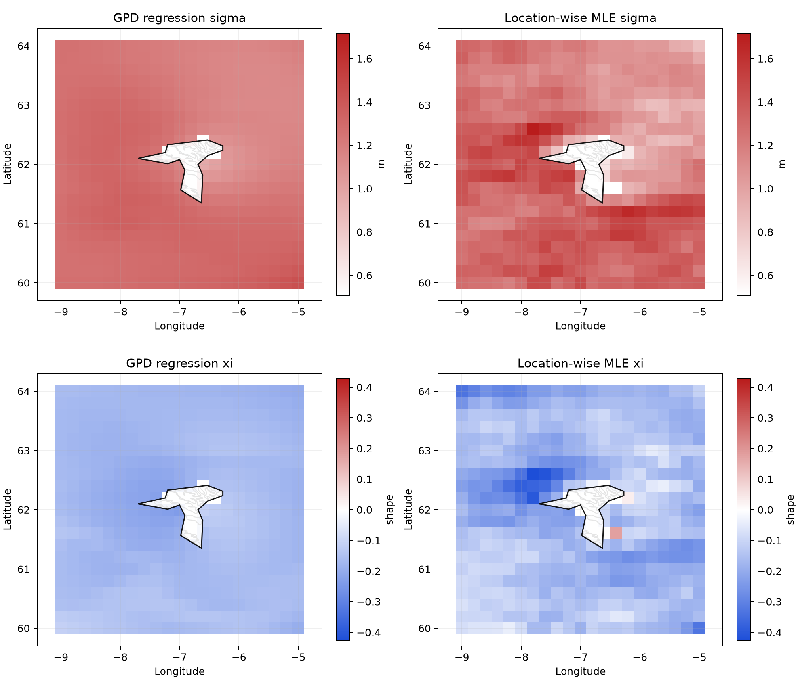

The GPD regression fit converged with:

- negative log likelihood: about 37,571
- median fitted `sigma`: about 1.27 m
- median fitted `xi`: about -0.169
- fitted `xi` range: roughly -0.237 to -0.112 in the earlier stored diagnostics

The negative fitted shape values imply bounded upper tails under the current model.  That is not a final scientific conclusion by itself; it is a model result conditional on this threshold choice, these covariates, and the current 5-day block-maxima construction.  It should be revisited with threshold sensitivity checks, uncertainty quantification, and posterior or bootstrap intervals before being used for return-level decisions.

The outputs of this stage — the fitted threshold `threshold_q95`, the location-wise MLEs, and the regression coefficients `beta_log_sigma` / `beta_logit_star_xi` — are bundled in `faroe_analysis/data/faroe_workflow_outputs.npz`.  Part II uses the threshold as given and the coefficients as starting values for the margins.

---

# Part II — Bayesian spatial-dependence modeling

Everything below starts from the Part I outputs in `faroe_analysis/data/`.

## 1. The three models

All three share Shi's **GPD + multiplicative Log-Laplace nugget** scale-mixture tail;
they differ in how they build spatial *dependence*:

| Model | `model_type` | Dependence structure |
|---|---|---|
| **HW** (Huser–Wadsworth) | `huser-wadsworth` | Stationary: one global Lévy scale R(t), scalar tail exponent, stationary Matérn Z-field. The simple baseline. |
| **Shi** (scale-aware) | `shi` | Non-stationary: knot-based random scale R(s), spatially-varying tail exponent φ(s) and range ρ(s), anisotropic Matérn. |
| **Wang** (non-convex) | `wang` | Like Shi **plus the physical barrier**: a *visibility graph* gives the Z-field a VisGP precision and the R-field visibility-filtered Wendland kernels, so dependence cannot "see through" the island. |

Wang is the model of primary interest — it is the one that encodes the sheltering.

---

## 2. The 7-task workflow

Each task has its own `run_faroe_task*.sh` (they `source faroe_analysis/scripts/_faroe_env.sh`
for the conda env + thread caps). Run them in order on a 64-rank server:

| Task | Script | What it does |
|---|---|---|
| 1 | `run_faroe_task1.sh` | Data prep → `faroe_analysis/output/inputs.{pkl,npz}` + review figures. **Serial.** |
| 2 | `run_faroe_task2.sh` | Fit **Wang** on the full dataset (432 sites) + diagnostics. |
| 3 | `run_faroe_task3.sh` | Fit **HW** on the training set. |
| 4 | `run_faroe_task4.sh` | Fit **Wang** on the training set. |
| 5 | `run_faroe_task5.sh` | Fit **Shi** on the training set. |
| 6 | `run_faroe_task6.sh` | Held-out **model comparison** (log-score, CRPS, TW-CRPS, WAIC). |
| 7 | `run_faroe_task7.sh` | **Assessment** of the full Wang fit (Gumbel QQ + χ maps). |

---

## 3. Environment

The runs use the `extremes` conda env (Intel MPI, `mpi4py`, `geopandas`, `shapely`,
plus `matplotlib`; no `netCDF4` needed -- the block maxima are read from a plain
`.npz`). `faroe_analysis/scripts/_faroe_env.sh` activates it and,
crucially, **pins one thread per rank**:

```bash
conda activate extremes
export OMP_NUM_THREADS=1 OPENBLAS_NUM_THREADS=1 MKL_NUM_THREADS=1 \
       NUMEXPR_NUM_THREADS=1 VECLIB_MAXIMUM_THREADS=1   # one thread per rank
export NRANKS=64
```

The thread caps matter: the sampler already parallelises across MPI ranks, so letting
BLAS spawn its own threads oversubscribes the cores (and, on some laptops, overheats
them). One thread per rank is both fastest and safest.

---

## 4. Task 1 — data preparation

`faroe_task1_prep.py` reads the marginal-workflow outputs plus the block-maxima field
and the reference package's cliques/coastline, and writes a single bundle that every
later task consumes. In short: *"gather everything the samplers need."*

```python
import faroe_setup as F
inp = F.prepare_inputs()      # loads block maxima, threshold, covariates, betas, knots,
                              # builds the split + the Wang junction trees
F.save_inputs(inp)            # -> faroe_analysis/output/inputs.pkl (+ inputs.npz)
```

`inputs.pkl` contains (all 432 ocean sites, in `np.where(~land_mask)` order):

| key | shape | meaning |
|---|---|---|
| `Y` | (432, 1656) | 5-day block-maxima wave heights (NaN = missing) |
| `sites_xy` | (432, 2) | lon/lat in degrees |
| `u_vec` | (432,) | 0.95-quantile threshold (the `threshold_q95` surface) |
| `sigma_vec`, `xi_vec` | (432,) | fitted GPD scale/shape (init + fallback) |
| `sigma_spatial`, `xi_spatial` | (432,10), (432,7) | marginal covariates, **intercept column dropped** |
| `beta_sigma`, `beta_xi` | (11,), (8,) | `beta_log_sigma` / `beta_logit_star_xi` — marginal warm-start |
| `knots_S`, `knots_phi`, `knots_rho` | (41,2)…(13,2) | Wendland / Gaussian knot grids (from the reference) |
| `block_id`, `train_idx`, `test_idx` | | train/test split |
| `full_cliques/separators`, `train_cliques/separators` | | Wang junction trees |

**Threshold & censoring.** `u_vec` is the actual per-site threshold value; the sampler
censors observations below it at level `p_cens = 0.95` (consistent because both come from
the same 0.95-quantile fit).

**Covariate intercept.** The covariate CSVs ship with a leading column of ones. spot-bayes
adds its own intercept, so we drop column 0 (asserting it is all-ones first). The provided
`beta_log_sigma` (length 11 = intercept + 10) and `beta_logit_star_xi` (length 8 =
intercept + 7) then map straight onto spot-bayes's `[intercept, spatial…]` layout.

**Knots** are ported verbatim from the reference
`Buffered_Data_Analysis_Stage2.py` (Wendland centers N_inner=16/N_outer=25 for S & φ;
Gaussian centers N_inner=4/N_outer=9 for ρ), excluding the buffered-land polygon.

**The barrier.** The *modeling* barrier is the 14-vertex "buffered land" polygon from the
reference package (not the literal coastline). The Wang visibility graph and barrier
kernels use it; the coastline shapefile is only for plotting the real island.

### Review these figures before fitting

The threshold surface already shows the sheltering — thresholds are markedly lower in the
island's lee (to the east) than in the open ocean to the south-west:

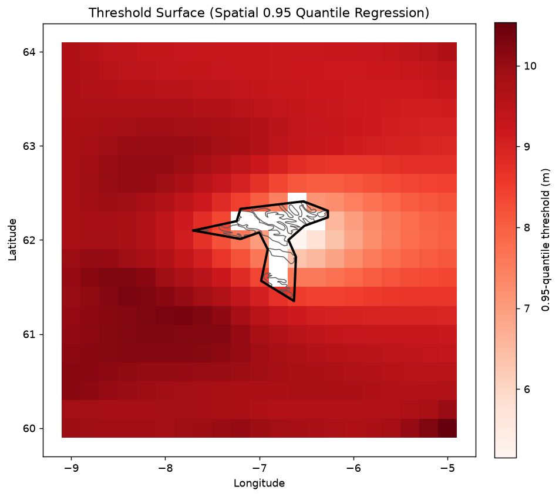

The train/test split holds out **three contiguous blocks** (~15% of sites): one hugging
the eastern shore (in the lee), one in the open ocean to the NW, and one to the south
abutting the barrier. Contiguous blocks (rather than random points) make the held-out
prediction a genuine *spatial extrapolation* test.

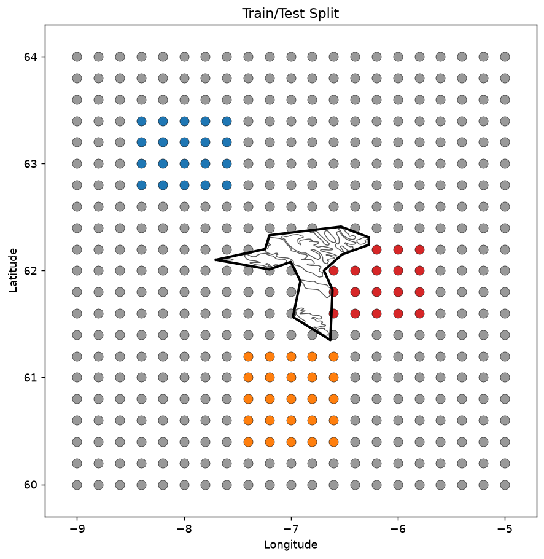

Knot layout (Wendland S/φ centers as stars, Gaussian ρ centers as +):

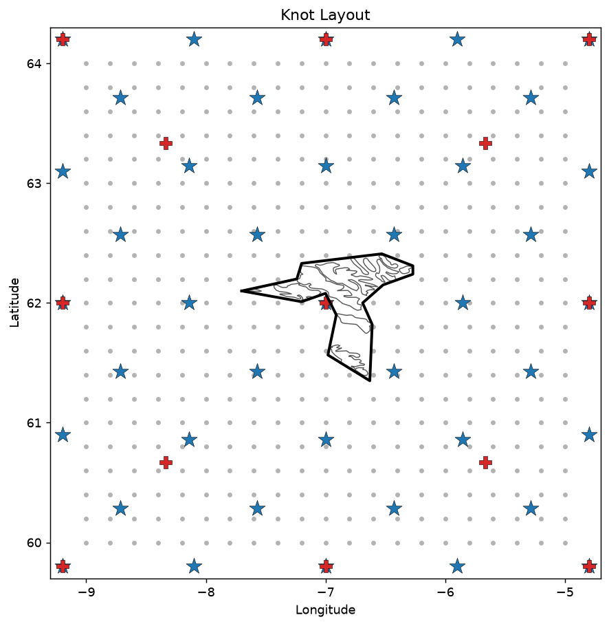

**A note on the Wang graph.** The provided `buffered_faroe_cliques.json` /
`buffered_faroe_separators.json` (converted from the reference .rds) are validated to be a genuine *separable* (junction-tree)
graph, and their node ordering matches our 432 sites exactly. For the *training* Wang fit
(a subset of sites) we recompute the junction tree on the training subgraph.

---

## 5. Running the samplers — MPI options

The samplers parallelise **over time replicates**: with `mpiexec -n N`, the 1656 block-
maxima "times" are split round-robin across the N ranks, and the global parameters are
kept in sync with an all-reduce each sweep. So:

```bash
# Serial (a laptop, debugging, or a short chain):
python faroe_analysis/scripts/faroe_fit.py --model hw --which train

# Parallel (a server) — one thread per rank, N ranks over time:
mpiexec -n 64 python faroe_analysis/scripts/faroe_fit.py --model wang --which full
```

Choosing `N` (`NRANKS`):

- **More ranks = fewer times per rank = faster iterations,** up to `N = Nt = 1656`.
  With 64 ranks each owns ~26 times — a good balance.
- On a **laptop**, use `NRANKS = physical cores` (e.g. 4–8) and keep the thread caps;
  the same code runs, just slower. A serial run (`python …`, no `mpiexec`) also works and
  is easiest to debug.
- On a **server**, match `NRANKS` to allocated cores (we use 64). Don't exceed the core
  count — with one thread per rank, oversubscription only adds contention.

**Checkpoint / resume.** Every fit auto-calibrates a checkpoint interval (~30 min of wall
time) and writes a resumable checkpoint. Relaunching the *same* command continues from the
last checkpoint (and *extends* the chain if you raise `FAROE_NITERS`). Resume is
rank-count-independent for the warm-start, though a checkpointed run resumes at its
original rank count. This makes long runs robust to interruptions.

Defaults (override via env vars, see `faroe_setup.py`): `FAROE_NITERS=50000`,
`FAROE_THIN=10` (→ ~5000 saved draws), `FAROE_SEED`, `FAROE_CKPT_HOURS=0.5`.

---

## 6. Sampler options — the knobs that matter

spot-bayes exposes many `SamplerSettings`. `faroe_setup.py` sets sensible, A/B-tested
defaults per model; here is what they mean and when to change them.

**Latent field Z (`z_sampler`).** The dependence field Z is the mixing bottleneck.
- `"nuts"` *(our default)* — per-time gradient NUTS; unfreezes Z and lets the global
  parameters (ν, α₀) move. **Recommended.**
- `"ess"` — elliptical slice sampling; tuning-free, robust, a good fallback.
- `"rwmh"` — the historical random-walk block; mixes Z only superficially. Avoid.

**Smoothness/range (`nu_rho_sampler`, Shi only).** ν and ρ sit on a correlated ridge.
- `"nuts"` *(our default for Shi)* — joint gradient NUTS on the ridge.
- `"separate"` — independent random-walk blocks; use if NUTS mis-behaves.
This is the hardest-mixing block in the whole model; watch its ESS.

**Tail exponent (`update_phi`, `joint_phi`).** Per-knot random-walk by default. `joint_phi`
blocks correlated knots together — occasionally helps, usually not; leave off.

**Wendland geometry (`update_radius_S`, `update_anisotropy`).** On for Shi/Wang: the
support radius and elliptical anisotropy of the R-field kernels. Anisotropy is where the
*directional* sheltering shows up.

**GPD margins (`update_GPD_sigma/xi`, `beta_sampler`).** We sample the marginal regression
coefficients (`beta_sampler="component"`, the robust per-coefficient default), warm-started
from the workflow's `beta_log_sigma` / `beta_logit_star_xi`. Set `update_GPD_*=False` to
freeze the margins at the plug-in fit instead.

**Wang barrier (`use_visgp`, `use_barrier_kernels`).** Both on for Wang: `use_visgp` gives
the Z-field its junction-tree precision; `use_barrier_kernels` filters the R-field Wendland
weights by line-of-sight through the water polygon. Together they are the sheltering
mechanism. `FAROE_WANG_BARRIER_KERNELS=0` disables the (heavier) R-field kernels if needed.

**How to warm-start the margins** (done automatically in the fit driver):

```python
from sampler import ModelState
st  = ModelState(cfg, data, settings)   # deterministic cold init
snap = st.snapshot()
snap["beta_sigma"] = inp["beta_sigma"]   # workflow's beta_log_sigma
snap["beta_xi"]    = inp["beta_xi"]      # workflow's beta_logit_star_xi
TR = run_mcmc_mpi(cfg, data, settings, init_snapshot=snap)
```

---

## 7. Tasks 2–5 — fitting

One driver, `faroe_fit.py`, fits any model on the full data or the training set:

```bash
# Task 2 — Wang, full data (all 432 sites)
mpiexec -n 64 python faroe_analysis/scripts/faroe_fit.py --model wang --which full
# Tasks 3/4/5 — HW / Wang / Shi on the training set
mpiexec -n 64 python faroe_analysis/scripts/faroe_fit.py --model hw   --which train
mpiexec -n 64 python faroe_analysis/scripts/faroe_fit.py --model wang --which train
mpiexec -n 64 python faroe_analysis/scripts/faroe_fit.py --model shi  --which train
```

Each writes to `faroe_analysis/output/` (full → `wang_full.*`; train → `train/<model>.*`):

- `<name>.npz` — parameter traces (φ, ρ, α₀, ν, radius, anisotropy, β_σ, β_ξ, ll);
- `<name>.Z.npy`, `<name>.S.npy` — streamed latent traces (needed for scoring/assessment);
- `<name>.trace.png` — live multi-panel trace + ESS plot (refreshed ~100 times over the
  run);
- `<name>.trace.surfaces.png` — companion live plot of the current-iteration spatial
  fields φ(s), σ(s) and ξ(s) (the latter two from the sampled GPD-margin β's), refreshed
  at the same cadence;
- `<name>.summary.*.png` — end-of-run trace/ESS + posterior-mean φ/ρ surfaces.

**Before trusting a fit,** open the `.summary` and `.trace` figures and the `.ess.json`:
check the log-likelihood has reached a stable regime and that the ν/ρ block has a healthy
effective sample size (it is the slowest). If ν/ρ is stuck, extend the chain
(`FAROE_NITERS`) or fall back to `nu_rho_sampler="separate"`.

---

## 8. Task 6 — model comparison on held-out sites

`faroe_task6_compare.py` loads the three *training* fits and scores each at the 63 held-out
sites, kriging the latent fields to the new locations per posterior draw. Held-out marginal
parameters are derived **per draw** from each model's sampled β's applied to the held-out
sites' covariates, so the scores account for marginal uncertainty.

```bash
mpiexec -n 64 python faroe_analysis/scripts/faroe_task6_compare.py          # all draws
mpiexec -n 64 python faroe_analysis/scripts/faroe_task6_compare.py -B 400 --M 30   # faster
```

Metrics (written to `faroe_analysis/output/compare/model_comparison.csv` + a bar chart):

- **Predictive log-score** — joint held-out log-likelihood (higher = better).
- **CRPS** — continuous ranked probability score, whole distribution (lower = better).
- **TW-CRPS** (hard + smooth) — *tail-weighted* CRPS, emphasising the extremes we care
  about (lower = better).
- **WAIC** — conditional (per-cell) WAIC on the training data (lower = better).

On a barrier domain we expect **Wang ≥ Shi ≥ HW** in the lee, where the sheltering matters;
the open-ocean holdout block should separate the models less.

---

## 9. Task 7 — assessment of the full Wang model

`faroe_task7_assess.py` (see `faroe_diagnostics.py` for the methodology) produces two
diagnostics for the full-data Wang fit, both following the shi-2026b / wang-2026a schemes:

```bash
mpiexec -n 64 python faroe_analysis/scripts/faroe_task7_assess.py
```

**(a) Site-wise Gumbel QQ plots** at four contrasting locations (open ocean, lee-of-island,
north, south). Observed exceedances are pushed through the **posterior-averaged**
censored-GPD CDF and mapped to the standard Gumbel scale (−log(−log F)); 95% bands come
from the Beta(k, n−k+1) law of the uniform order statistics. Points inside the bands ⇒ the
marginal model fits at that site. → `faroe_analysis/output/assess/qq.png`.

**(b) Extremal-dependence χ(u) relative to reference locations** (à la Figure 2 of
wang-2026a — *not* a moving window). For a few reference sites we map χ(u) of every other
site *relative to that reference*, comparing:

- **empirical** χ — rank-transform the observed series to uniform margins, then
  χ_ij(u) = P(U_i > u, U_j > u)/(1 − u);
- **model-based** χ — for each posterior draw, simulate fresh replicates from the fitted
  process, rank-transform, and average χ over draws.

→ `faroe_analysis/output/assess/chi_ref*.png` (one figure per reference: rows = empirical vs model,
columns = u ∈ {0.90, 0.95, 0.98}), plus `chi.npz`. The signature to look for is
**anisotropic χ that drops across the barrier** — dependence that is strong along the open
ocean but weak into the sheltered lee, and a model surface that tracks the empirical one.

Adjust the QQ sites and χ reference locations at the top of `faroe_task7_assess.py`
(`QQ_SITES`, `CHI_REFS`).

---

## 10. Reproducing / tuning

- **Faster smoke run:** `FAROE_NITERS=2000 FAROE_THIN=2 NRANKS=8 ./faroe_analysis/scripts/run_faroe_task3.sh`.
- **Change the split:** edit `BLOCK_E/BLOCK_NW/BLOCK_S` in `faroe_setup.py`, re-run Task 1,
  eyeball `faroe_analysis/output/figures/split.png`.
- **Freeze the margins:** set `update_GPD_sigma/xi=False` in `faroe_setup.models()`.
- **Model files:** `faroe_analysis/scripts/faroe_setup.py` (shared setup), `faroe_fit.py` (fit driver),
  `faroe_task{1,6,7}_*.py`, `faroe_diagnostics.py` (χ + QQ), `run_faroe_task*.sh`.

All fits checkpoint and resume, so a long production run can be launched, interrupted, and
relaunched with the identical command.
