# New Zealand South Island Extreme Precipitation — Modeling Vignette

This vignette walks through a full spatial-extremes analysis of atmospheric-river
precipitation on New Zealand's South Island.  It is the precipitation analogue of the
Faroe wave-height analysis (`faroe_analysis/`).

- **Part I — data and marginal pre-processing** takes upscaled ERA5 January–April
  precipitation down to storm-scale 3-day sums, fits a spatial
  **0.95-quantile-regression threshold**, and fits a **GPD marginal model** (spatially
  varying scale σ and shape ξ) by maximum likelihood.  Its outputs ship in
  `nz_analysis/data/`, so you never need to re-run it.
- **Part II — Bayesian spatial-dependence modeling** fits three full Bayesian
  spatial-extremes models with the [`spot-bayes`](https://github.com/bshaby/spot-bayes)
  package, compares them on held-out locations, and assesses the best one.

The scientific question is **orographic sheltering**: moisture-laden atmospheric rivers
arrive from the west/north-west, the Southern Alps wring them out on the windward side,
and the **leeward (south-east) side lies in a rain shadow** — so the *extremal
dependence* should be anisotropic and shaped by the barrier.

All the modeling code lives in `nz_analysis/scripts/` as `nz_*.py` and
`run_nz_task*.sh`.

---

# Part I — Data and marginal pre-processing

Part I is reproduced by `nz_analysis/scripts/nz_preprocess.py` (serial, under a
minute). It writes to `nz_analysis/output/preprocess/` and matches the shipped
`data/nz_workflow_outputs.npz` to optimizer tolerance; the figures below are its output.
Chien-Chung Wang prepared the upscaled daily precipitation, covariates and visibility
graph it starts from.

## I.1 Problem and domain

The target is extreme atmospheric-river precipitation on and around New
Zealand's South Island. The Southern Alps affect spatial dependence and rainfall
exposure, so the 1500 m contour is used as a barrier. For mapping, the barrier
alone is not enough because it encloses the mountains rather than the coastline;
the figures therefore show Natural Earth coastline, SRTM topography, model
sites, and the 1500 m barrier together.

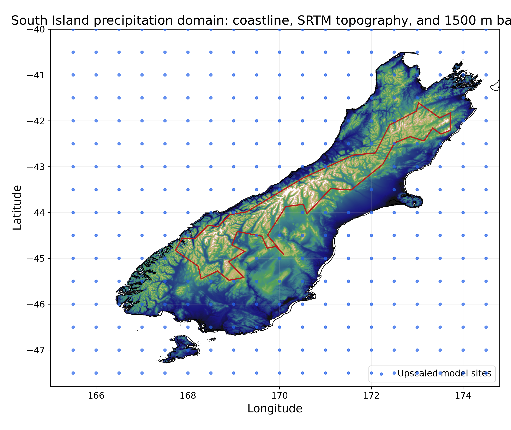

## I.2 Dataset and storm-scale blocks

The starting point is ECMWF ERA5 reanalysis precipitation (Copernicus Climate Change Service; DOI [10.24381/cds.adbb2d47](https://doi.org/10.24381/cds.adbb2d47), CC BY 4.0), aggregated over the South Island to daily totals and upscaled to a coarser grid.  The record is restricted to the January–April season, the period that Reid, K. J., Rosier, S. M., Harrington, L. J., King, A. D. and Lane, T. P. (2021), "Extreme rainfall in New Zealand and its association with Atmospheric Rivers", *Environmental Research Letters* 16, 044012, doi:[10.1088/1748-9326/abeae0](https://doi.org/10.1088/1748-9326/abeae0) found holds about 60% of New Zealand's extreme rainfall events, most of them associated with atmospheric rivers (hence "ARs" in the file names).  The upscaled grid has 323 cells, while the covariates and visibility graph use 309 model sites, so we keep that 309-site subset.

The daily record covers the January–April seasons from 1950 through 2026.  To reduce serially dependent observations to storm-scale data (the same idea as the 5-day block maxima in the Faroe analysis), we use non-overlapping 3-day precipitation sums.  In 121-day seasons the leftover final day is dropped so every time slice has the same duration.  This gives 3080 3-day blocks at 309 sites, stored as `blocks` in `nz_analysis/data/nz_workflow_outputs.npz`.

## I.3 Why 3-day sums?

The storm-duration EDA uses regional daily site-total precipitation. The site-total
autocorrelation is 0.364 at lag 1, 0.066 at lag 2, and 0.004 at lag 3. That supports 3-day sums as a first storm-scale reduction.

This choice is also consistent with the New Zealand atmospheric-river literature.
Pohl et al. (2023, JGR Atmospheres, doi:10.1029/2022JD037209) report that AR
median duration varies by weather type from about 6 hours to about 18 hours,
with the longest events reaching or exceeding 4 days. Prince et al. (2021,
Journal of Climate, doi:10.1175/JCLI-D-20-0664.1) emphasize 3-day precipitation
totals for high-rank New Zealand ARs, including rank-5 totals above 1000 mm on
the windward side of the Southern Alps; Prince (2020, MSc thesis, University of Otago,
https://hdl.handle.net/10523/10221) similarly reports the most
intense West Coast events exceeding 1000 mm within roughly 60 hours. A recent
New Zealand extreme-precipitation study also stresses that event duration is a
major control on total accumulation (Vishwanathan et al. 2024,
doi:10.1016/j.wace.2024.100687).

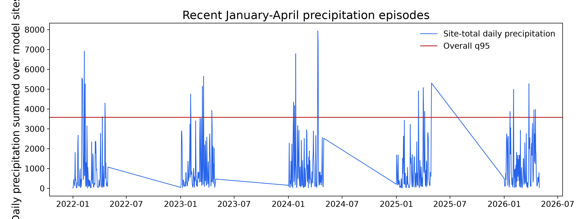

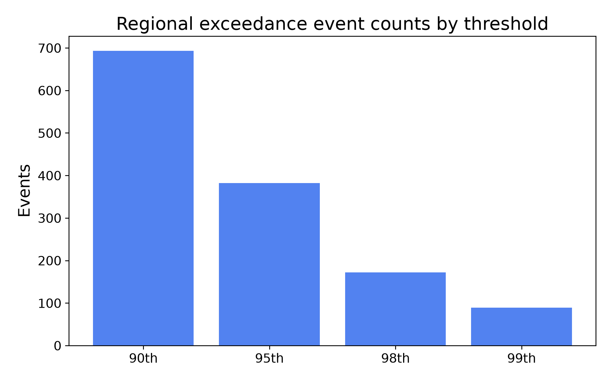

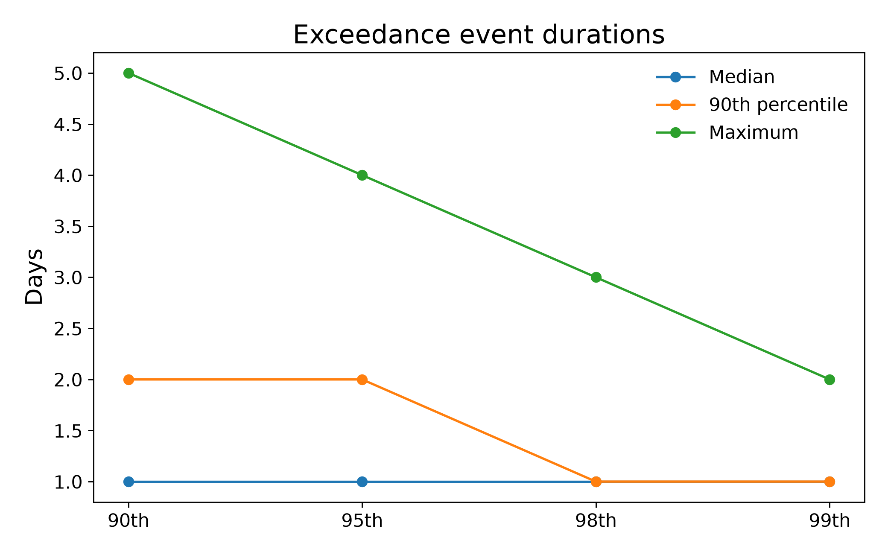

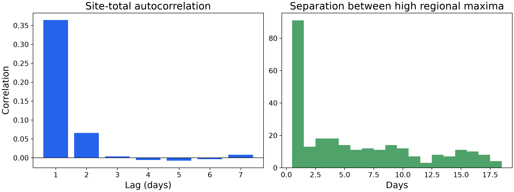

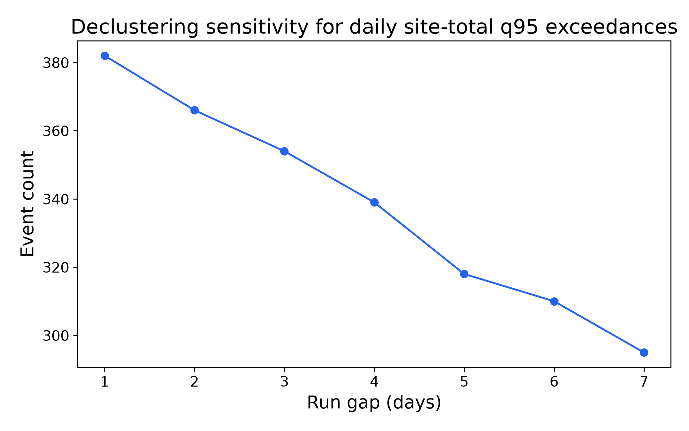

## I.4 0.95 quantile regression

For each model site, the empirical 0.95 quantile of 3-day sums is computed. A
pooled quantile regression at tau=0.95 is then fit using spatial covariates built for
the same 309 sites (the `sigma` and `xi` sets ship as
`data/sigma_covariates_std_NZ_precip.csv` and `data/xi_covariates_std_NZ_precip.csv`).

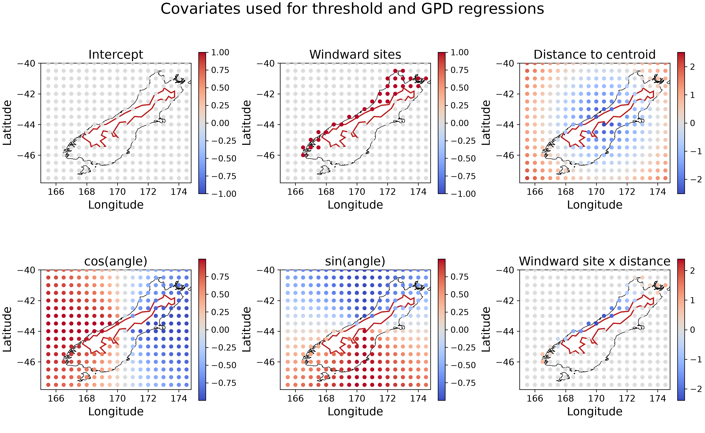

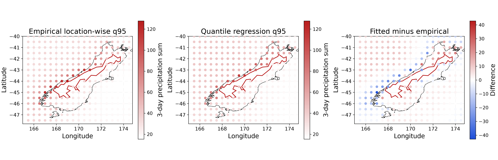

The fit gives:

- q95 RMSE against empirical location-wise q95: 9.467
- q95 MAE against empirical location-wise q95: 7.002

## I.5 GPD analysis above the fitted 0.95 threshold

The fitted q95 surface is used as the threshold for positive exceedances of the
3-day precipitation sums. The scale parameter uses a log link and the shape
parameter is constrained to `(-0.5, 1)` with the same transformed logistic link
as the Faroe analysis: `xi = -0.5 + 1.5 * logistic(x' beta_xi)`.

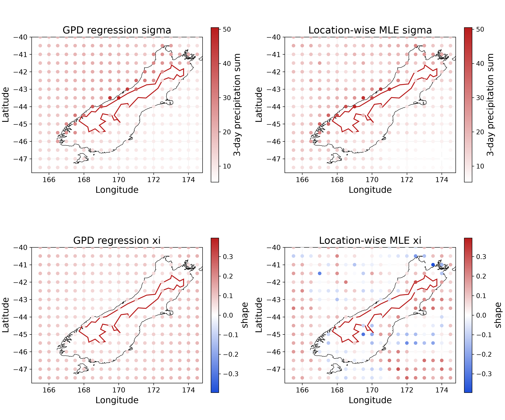

The GPD regression fit gives:

- exceedances: 47589
- negative log likelihood: 179750.810
- median fitted sigma: 13.970
- median fitted xi: 0.096
- optimizer success flag: 1

The outputs of this stage — the fitted threshold `threshold_q95`, the location-wise MLEs, and the regression coefficients `beta_log_sigma` / `beta_logit_star_xi` — are bundled in `nz_analysis/data/nz_workflow_outputs.npz`.  Part II uses the threshold as given and the coefficients as starting values for the margins.

---

# Part II — Bayesian spatial-dependence modeling

Everything below starts from the Part I outputs in `nz_analysis/data/`.

## 0. The barrier is 1500 m, not 1200 m

The upstream pre-processing labelled the visibility graph a **1200 m** barrier, **but the pre-built visibility graph is actually a 1500 m graph.**
We verified this directly against the two candidate contour shapefiles:

| Barrier | Model sites inside | Adjacency edges crossing it |
|---|---|---|
| 1200 m | **12** of 309 | **4908** of 26566 |
| **1500 m** | **0** of 309 | **0** of 26566 |

A visibility graph built against barrier *B* has no edges that cross *B* and no nodes
inside it. `NZ_SI_adjacency_matrix.csv` satisfies this for **1500 m only**. This
analysis therefore uses the **1500 m** contour (`data/barrier_1500m/`), which keeps all
309 sites and lets us reuse the adjacency matrix turnkey. (Choosing 1200 m would force
dropping the 12 in-barrier sites and rebuilding the junction tree from scratch.)

---

## 1. The three models

All three share Shi's **GPD + multiplicative Log-Laplace nugget** scale-mixture tail
([Shi, Zhang and Shaby, 2026](https://arxiv.org/abs/2604.07640)); they differ in how they build spatial *dependence*
(the barrier-aware `wang` model is [Wang and Shaby, 2026](https://arxiv.org/abs/2611.23565)):

| Model | `model_type` | Dependence structure |
|---|---|---|
| **HW** (Huser–Wadsworth) | `huser-wadsworth` | Stationary: one global Lévy scale R(t), scalar tail exponent, stationary Matérn Z-field. The simple baseline. |
| **Shi** (scale-aware) | `shi` | Non-stationary: knot-based random scale R(s), spatially-varying tail exponent φ(s) and range ρ(s), anisotropic Matérn. |
| **Wang** (non-convex) | `wang` | Like Shi **plus the physical barrier**: a *visibility graph* gives the Z-field a VisGP precision and the R-field visibility-filtered Wendland kernels, so dependence cannot "see through" the Alps. |

Wang is the model of primary interest — it is the one that encodes the sheltering.

---

## 2. The workflow

Each step has its own `run_nz_*.sh` (they `source nz_analysis/scripts/_nz_env.sh` for the
conda env + thread caps). Run them in order; `NRANKS` defaults to **16**, so tasks 2–5 can
run as four concurrent jobs — each a 16-core allocation, which the scheduler places
independently (they need not, and preferably do not, share a node).

| Step | Script | What it does |
|---|---|---|
| 1 | `run_nz_task1.sh` | Data prep → `nz_analysis/output/inputs.{pkl,npz}` + review figures. **Serial.** |
| — | `run_nz_marginal.sh` | **Stage 1**: GPD margins on the exceedances alone. **Serial.** Required by 2–5. |
| 2 | `run_nz_task2.sh` | Fit **Wang** on the full dataset (309 sites) + diagnostics. |
| 3 | `run_nz_task3.sh` | Fit **HW** on the training set. |
| 4 | `run_nz_task4.sh` | Fit **Wang** on the training set. |
| 5 | `run_nz_task5.sh` | Fit **Shi** on the training set. |
| 6 | `run_nz_task6.sh` | Held-out **model comparison** (log-score, CRPS, TW-CRPS, WAIC). |
| 7 | `run_nz_task7.sh` | **Assessment** of the full Wang fit (Gumbel QQ + χ maps). |

Tasks 2–5 are **stage 2**: they hold the margins frozen at the stage-1 posterior-mean
surface and sample only the dependence field, starting from the plug-in field of
§6.1. Their output is named `<model>_fixmargins_stage1_plug.*`.

---

## 3. Environment

The runs use the `extremes` conda env (`mpi4py`, `geopandas`, `shapely`, `networkx`,
`matplotlib`). `nz_analysis/scripts/_nz_env.sh` activates it, points `PROJ_LIB` at the
env's PROJ data (geopandas reads the barrier + coastline shapefiles), and **pins one
thread per rank**:

```bash
conda activate extremes
export OMP_NUM_THREADS=1 OPENBLAS_NUM_THREADS=1 MKL_NUM_THREADS=1 \
       NUMEXPR_NUM_THREADS=1 VECLIB_MAXIMUM_THREADS=1   # one thread per rank
export NRANKS=16      # default; raise for a single fit you want back fast
```

The thread caps matter: the sampler already parallelises across MPI ranks, so letting
BLAS spawn its own threads oversubscribes the cores. One thread per rank is both fastest
and safest. Run `run_nz_preflight.sh` first — it checks the deps, that the barrier
shapefile loads through geopandas/PROJ, and that `mpiexec` and `mpi4py` agree.

---

## 4. Task 1 — data preparation

`nz_task1_prep.py` reads the workflow npz plus the covariates and the 1500 m visibility
adjacency matrix, and writes a single bundle every later task consumes. In short:
*"gather everything the samplers need."*

```python
import nz_setup as N
inp = N.prepare_inputs()      # loads 3-day sums, threshold, covariates, betas, knots,
                              # builds the split + the Wang junction trees
N.save_inputs(inp)            # -> nz_analysis/output/inputs.pkl (+ inputs.npz)
```

`inputs.pkl` contains (all 309 model sites, in the workflow npz's canonical order):

| key | shape | meaning |
|---|---|---|
| `Y` | (309, 3080) | 3-day precipitation sums (mm) |
| `sites_xy` | (309, 2) | lon/lat in degrees (WGS84) |
| `u_vec` | (309,) | 0.95-quantile threshold (the `threshold_q95` surface, mm) |
| `sigma_vec`, `xi_vec` | (309,) | fitted GPD scale/shape (init + fallback) |
| `sigma_spatial`, `xi_spatial` | (309,5), (309,5) | marginal covariates, **intercept column dropped** |
| `beta_sigma`, `beta_xi` | (6,), (6,) | `beta_log_sigma` / `beta_logit_star_xi` — marginal warm-start |
| `knots_S`, `knots_phi`, `knots_rho` | (39,2),(39,2),(24,2) | Wendland / Gaussian knot grids |
| `block_id`, `train_idx`, `test_idx` | | train/test split (0=train, 1=NW, 2=SE) |
| `full_cliques/separators`, `train_cliques/separators` | | Wang junction trees |

Task 1 prints, and you should sanity-check, that there are **47 589 exceedances** (this
matches Part I, §I.5, exactly — a good check that `Y` and `u_vec` line up).

**Threshold & censoring.** `u_vec` is the per-site threshold value; the sampler censors
observations below it at `p_cens = 0.95` (consistent — both come from the same
0.95-quantile fit).

**Covariate intercept.** `sigma/xi_covariates_std_NZ_precip.csv` ship with a leading
column of ones (`Intercept, Windward, Distance-to-centroid, cos(angle), sin(angle),
Windward×distance`). spot-bayes adds its own intercept, so we drop column 0 (asserting
it is all-ones first). `beta_log_sigma` and `beta_logit_star_xi` (length 6 = intercept +
5) then map onto spot-bayes's `[intercept, spatial…]` layout.

**Knots** (`nz_setup.make_knots`): Wendland centers for S & φ = **39** (an interleaved
inner mesh + a padded outer ring), Gaussian centers for ρ = **24** (a coarser mesh + an
outer ring with two evenly-spaced knots per edge). Both **exclude the barrier interior**
— no knot sits inside the 1500 m contour.

**The barrier & modelling domain.** The modelling barrier is the **1500 m contour**
(loaded from the shapefile). The Wang visibility graph and barrier kernels use the
modelling polygon = domain box − barrier (so dependence lines cannot cross the high
Alps); the Natural Earth coastline is only for plotting.

### Review these figures before fitting

The threshold surface already shows the sheltering — thresholds are markedly higher on
the windward west coast / western Alps (dark, ~100 mm) than in the leeward east and
offshore:

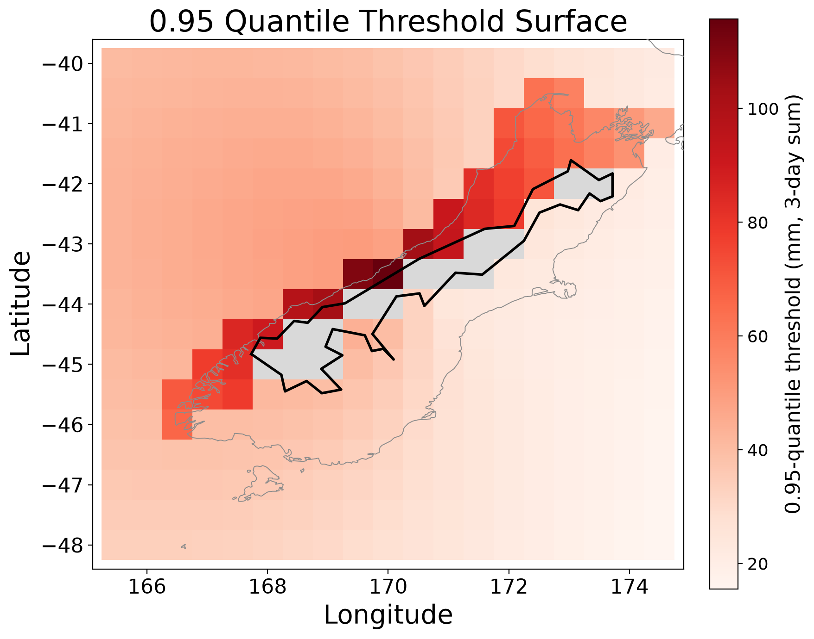

The train/test split holds out **two contiguous blocks** (~11% of sites): an open-ocean
**windward** rectangle to the NW, and a **leeward** strip hugging the SE flank of the
barrier (its convex hull is drawn dotted). Contiguous blocks (rather than random points)
make the held-out prediction a genuine *spatial extrapolation* test — and the
windward-vs-leeward contrast is exactly the sheltering signal.

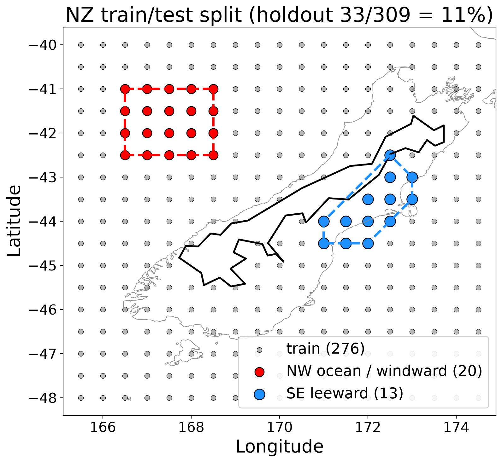

Knot layout (Wendland S/φ centers as stars, Gaussian ρ centers as ×):

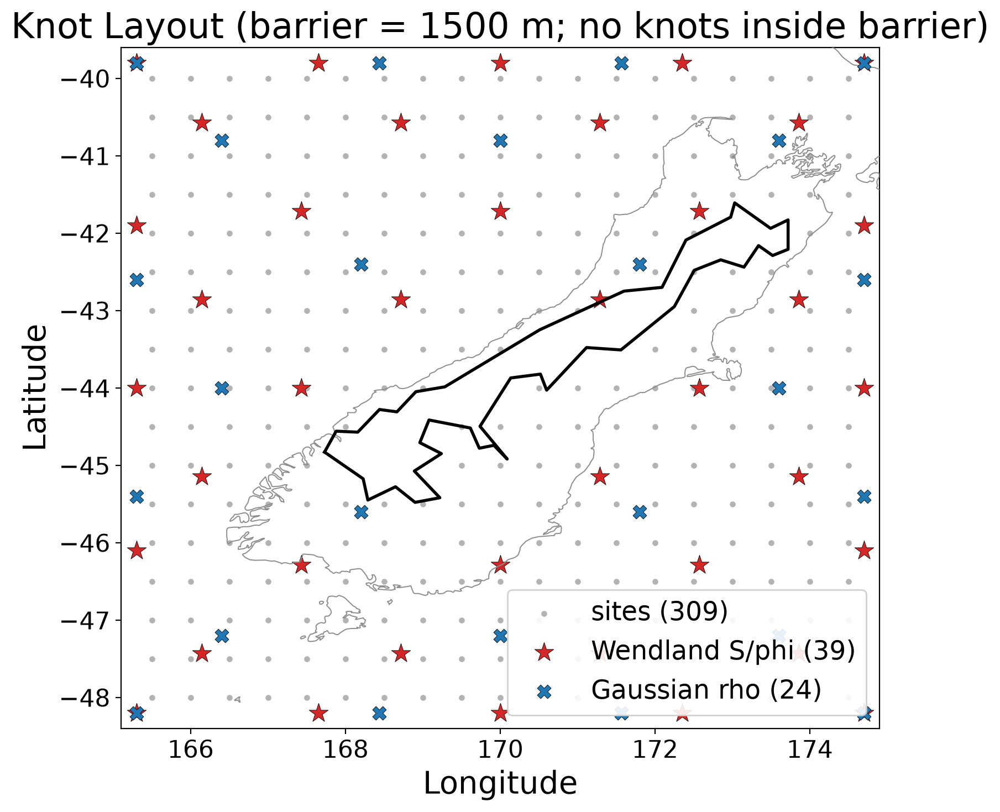

**A note on the Wang graph.** `nz_setup.prepare_inputs` builds the full-graph junction
tree by triangulating `NZ_SI_adjacency_matrix.csv` (the 1500 m visibility graph) and
verifying the running-intersection property (72 cliques / 71 separators over the 309
nodes). For the *training* Wang fit it uses the **induced subgraph** on the training
sites — pairwise visibility is unchanged by dropping sites, so the induced subgraph is
exactly the training-sites' visibility graph (62 cliques / 61 separators). A JSON copy
of the full cliques is written to `data/nz_cliques.json` to satisfy
`ModelConfig.cliques_path`; the cliques actually used come from the `SamplerData`.

---

## 5. Running the samplers — MPI options

The samplers parallelise **over time replicates**: with `mpiexec -n N`, the 3080
3-day-sum "times" are split round-robin across the N ranks, and the global parameters
are kept in sync with an all-reduce each sweep. So:

```bash
# Serial (a laptop, debugging, or a short chain):
python nz_analysis/scripts/nz_fit.py --model hw --which train

# Parallel (a server) — one thread per rank, N ranks over time:
mpiexec -n 64 python nz_analysis/scripts/nz_fit.py --model wang --which full
```

Choosing `N` (`NRANKS`):

- **More ranks = fewer times per rank = faster iterations,** up to `N = Nt = 3080`.
  With 64 ranks each owns ~48 times — a good balance.
- On a **laptop**, use `NRANKS = physical cores` (e.g. 4–8) and keep the thread caps; a
  serial run (`python …`, no `mpiexec`) also works and is easiest to debug.
- On a **server**, match `NRANKS` to allocated cores (we use 64). Don't exceed the core
  count — with one thread per rank, oversubscription only adds contention.

**Checkpoint / resume.** Every fit auto-calibrates a checkpoint interval (~30 min of
wall time) and writes a resumable checkpoint. Relaunching the *same* command continues
from the last checkpoint (and *extends* the chain if you raise `NZ_NITERS`). This makes
long runs robust to interruptions.

Defaults (override via env vars, see `nz_setup.py`): `NZ_NITERS=50000`, `NZ_THIN=10`
(→ ~5000 saved draws), `NZ_SEED`, `NZ_CKPT_HOURS=0.5`.

---

## 6. Sampler options — the knobs that matter

spot-bayes exposes many `SamplerSettings`. `nz_setup.py` sets sensible defaults per
model; here is what they mean and when to change them.

**Latent field Z (`z_sampler`).** The dependence field Z is the mixing bottleneck.
- `"nuts"` *(our default)* — per-time gradient NUTS; unfreezes Z and lets the global
  parameters (ν, α₀) move. **Recommended.**
- `"ess"` — elliptical slice sampling; tuning-free, robust, a good fallback.
- `"rwmh"` — the historical random-walk block; mixes Z only superficially. Avoid.

**Smoothness/range (`nu_rho_sampler`, Shi only).** ν and ρ sit on a correlated ridge.
- `"nuts"` *(our default for Shi)* — joint gradient NUTS on the ridge.
- `"separate"` — independent random-walk blocks; use if NUTS mis-behaves.
This is the hardest-mixing block in the whole model; watch its ESS.

**Tail exponent (`update_phi`).** Per-knot random-walk by default.

**Wendland geometry (`update_radius_S`, `update_anisotropy`).** On for Shi/Wang: the
support radius and elliptical anisotropy of the R-field kernels. Anisotropy is where the
*directional* (windward/leeward) sheltering shows up.

**GPD margins (`update_GPD_sigma/xi`, `beta_sampler`).** Production runs **freeze**
them: `nz_fit.py --fix-margins` turns `update_GPD_*` off and pins σ/ξ at the stage-1
posterior-mean surface. Sampling them instead (`beta_sampler="component"`, warm-started
from the stage-1 mean or the workflow betas) is still available by dropping the flag —
but the betas and the latent field weld to each other through the nugget `X ≈ X*`, and
the pair can settle far from a calibrated margin with no single-block move able to come
back. That is why stage 1 exists.

**Wang barrier (`use_visgp`, `use_barrier_kernels`).** Both on for Wang: `use_visgp`
gives the Z-field its junction-tree precision; `use_barrier_kernels` filters the R-field
Wendland weights by line-of-sight through the modelling polygon. Together they are the
sheltering mechanism. `NZ_WANG_BARRIER_KERNELS=0` disables the (heavier) R-field kernels
if needed.

### 6.1 Starting values — the plug-in field

The sampler's cold init (`S=1, Z=0, φ=1, α₀=5, ρ=1`) is the **Z-prior mode**: the data
likelihood is exactly flat in (ν, ρ) there, so the chain must first inflate a 309×3080
Gaussian field out to its typical set before the covariance parameters are identified at
all. That inflation *is* the long transient.

`init_field.py` (package-level, dataset-generic) replaces it. With the margins fixed, the
transformed data `X = qRW(pCGP(Y))` is computable, so the model

    X = R^φ · g(Z) · ε,   g(Z) = 1/Φ̄(Z),   ε ~ log-Laplace(α₀)

can be **inverted** for a starting field: uniformize Y (exact `pCGP` above the threshold,
within-site empirical ranks below it), transform to X, split `log X = φ·log R + log g(Z)`
using `log g(Z) ~ Exp(1)`, and read Z off the residual. The one free scalar (the S-basis
shrinkage λ, or the offset for HW's single knot) is solved so that **sd(Z) = 1** — Z must
be marginally N(0,1) under the model, which makes the split self-calibrating. ν and ρ are
then fitted to the resulting correlogram.

| start | data log-lik |
|---|---|
| cold default | −2,230,008 |
| scalars only (φ=0.5, α₀=2.05), S=1, Z=0 | −730,053 |
| **+ plug-in S/Z field** | **≈ −138,600** |

α₀ alone accounts for ~1.2M nats. The plug-in Z also lands **inside** the typical set
(quadratic form 825k vs the expected `Ns·Nt` = 952k) rather than at the mode — so raw
log-joint comparisons against `Z=0` are misleading, and the calibration target is sd(Z),
not the joint.

Fitted for NZ: **ρ ≈ 1.46, ν ≈ 2.0**. Do **not** carry ρ over from Faroe (ρ = 3): NZ's
maximum site separation is 12.0° against Faroe's 5.7°, and NZ's latent correlation is
already ≈ 0 at its median separation (4.7°) where Faroe's was still 0.49.

φ is a **choice, not a fit** — a larger φ simply moves variation out of Z and into R, so
the split cannot identify it. `NZ_PHI0=0.5` is the asymptotic independence/dependence
boundary.

**Margin sources.** The initializer takes them from, in order: explicit `beta_sigma`/
`beta_xi` (the stage-1 posterior mean, or any initial guess when there is no stage 1);
else the fixed `data.sigma_vec`/`xi_vec`; else `ModelState`'s intercept-only default. So
it works for a full joint dependence+marginal fit too, and always has a fallback.

Knobs: `NZ_PHI0`, `NZ_ALPHA0`, `NZ_PLUGIN_INIT=0` / `--no-plugin-init` to cold-start,
`--nu0` / `--rho0` to pin the covariance instead of fitting it.

---

## 7. Tasks 2–5 — fitting

One driver, `nz_fit.py`, fits any model on the full data or the training set:

```bash
# Task 2 — Wang, full data (all 309 sites)
mpiexec -n 64 python nz_analysis/scripts/nz_fit.py --model wang --which full
# Tasks 3/4/5 — HW / Wang / Shi on the training set
mpiexec -n 64 python nz_analysis/scripts/nz_fit.py --model hw   --which train
mpiexec -n 64 python nz_analysis/scripts/nz_fit.py --model wang --which train
mpiexec -n 64 python nz_analysis/scripts/nz_fit.py --model shi  --which train
```

Each writes to `nz_analysis/output/` (full → `wang_full.*`; train → `train/<model>.*`):

- `<name>.npz` — parameter traces (φ, ρ, α₀, ν, radius, anisotropy, β_σ, β_ξ, ll);
- `<name>.Z.npy`, `<name>.S.npy` — streamed latent traces (needed for scoring/assessment);
- `<name>.trace.png` — live multi-panel trace + ESS plot (refreshed ~100 times);
- `<name>.trace.surfaces.png` — live spatial fields φ(s), σ(s), ξ(s);
- `<name>.summary.*.png` — end-of-run trace/ESS + posterior-mean φ/ρ surfaces.

**Before trusting a fit,** open the `.summary` and `.trace` figures: check the
log-likelihood has reached a stable regime and that the ν/ρ block has a healthy
effective sample size (it is the slowest). If ν/ρ is stuck, extend the chain
(`NZ_NITERS`) or fall back to `nu_rho_sampler="separate"`.

---

## 8. Task 6 — model comparison on held-out sites

`nz_task6_compare.py` loads the three *training* fits and scores each at the 33 held-out
sites (NW windward + SE leeward), kriging the latent fields to the new locations per
posterior draw. Held-out marginal parameters are derived **per draw** from each model's
sampled β's applied to the held-out sites' covariates, so the scores account for
marginal uncertainty.

```bash
mpiexec -n 64 python nz_analysis/scripts/nz_task6_compare.py            # all draws
mpiexec -n 64 python nz_analysis/scripts/nz_task6_compare.py -B 400 --M 30   # faster
```

Metrics (written to `nz_analysis/output/compare/model_comparison.csv` + a bar chart):

- **Predictive log-score** — joint held-out log-likelihood (higher = better).
- **CRPS** — continuous ranked probability score, whole distribution (lower = better).
- **TW-CRPS** (hard + smooth) — *tail-weighted* CRPS, emphasising the extremes (lower =
  better).
- **WAIC** — conditional (per-cell) WAIC on the training data (lower = better).

On a barrier domain we expect **Wang ≥ Shi ≥ HW** on the leeward SE block, where the
sheltering matters; the windward NW block should separate the models less.

---

## 9. Task 7 — assessment of the full Wang model

`nz_task7_assess.py` (see `nz_diagnostics.py` for the methodology) produces two
diagnostics for the full-data Wang fit:

```bash
mpiexec -n 64 python nz_analysis/scripts/nz_task7_assess.py
```

**(a) Site-wise Gumbel QQ plots** at four contrasting locations (windward W-coast,
leeward SE, north, south). Observed exceedances are pushed through the
**posterior-averaged** censored-GPD CDF and mapped to the standard Gumbel scale
(−log(−log F)); 95% bands come from the Beta(k, n−k+1) law of the uniform order
statistics. Points inside the bands ⇒ the marginal model fits at that site.
→ `nz_analysis/output/assess/qq.png`.

**(b) Extremal-dependence χ(u) relative to reference locations** (à la Figure 2 of
wang-2026a — *not* a moving window). For a few reference sites we map χ(u) of every
other site *relative to that reference*, comparing:

- **empirical** χ — rank-transform the observed series to uniform margins, then
  χ_ij(u) = P(U_i > u, U_j > u)/(1 − u);
- **model-based** χ — for each posterior draw, simulate fresh replicates from the fitted
  process, rank-transform, and average χ over draws (both the *marginal* construction —
  fresh latent fields — and the *conditional* one — the inferred latent field — are
  reported).

→ `nz_analysis/output/assess/chi_ref*.png` (one figure per reference: rows = empirical
vs model marginal/conditional, columns = u ∈ {0.90, 0.95, 0.98}), plus `chi.npz`. The
signature to look for is **anisotropic χ that drops across the Alps** — dependence that
is strong along the windward flank but weak into the sheltered leeward rain shadow, and
a model surface that tracks the empirical one.

Adjust the QQ sites and χ reference locations at the top of `nz_task7_assess.py`
(`QQ_SITES`, `CHI_REFS`).

---

## 10. Reproducing / tuning

- **Faster smoke run:** `NZ_NITERS=2000 NZ_THIN=2 NRANKS=8 ./nz_analysis/scripts/run_nz_task3.sh`.
- **Change the split:** edit `BLOCK_NW` / `SE_SITES` in `nz_setup.py`, re-run Task 1,
  eyeball `nz_analysis/output/figures/split.png`.
- **Freeze the margins:** set `update_GPD_sigma/xi=False` in `nz_setup.models()`.
- **Model files:** `nz_analysis/scripts/nz_setup.py` (shared setup), `nz_fit.py` (fit
  driver), `nz_task{1,6,7}_*.py`, `nz_diagnostics.py` (χ + QQ), `run_nz_task*.sh`.

All fits checkpoint and resume, so a long production run can be launched, interrupted,
and relaunched with the identical command.
